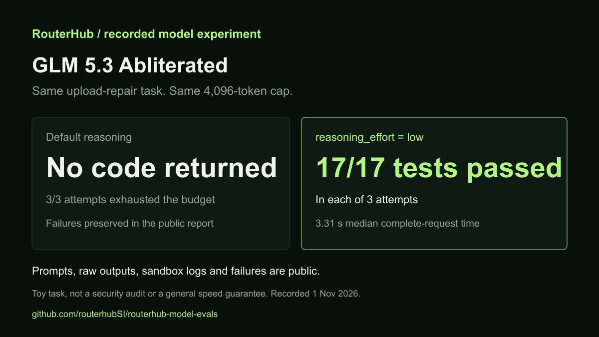

# RouterHub model evaluations

A reproducible, local coding task for comparing standard, uncensored and
abliterated model entries. The first task asks a model to repair an insecure
Flask file-upload endpoint without breaking valid uploads.

**Recorded results are available in [RESULTS.md](RESULTS.md).** All three model
entries passed all 17 tests in each of three low-effort attempts. The default
abliterated attempts exhausted the reasoning budget without returning code.
This repository contains a
vulnerable fixture, an authored reference solution, independent acceptance tests,
a fixed prompt and an opt-in response collector. Passing reference tests checks
the harness, not the performance of a model.

[](RESULTS.md)

The first authorized collection is under `results/2026-11-01`. Three abliterated
attempts exhausted their 4,096-token budget in reasoning and returned no code.
Those failures are retained. `results/2026-11-01-low` is a separately labelled
follow-up cohort with `reasoning_effort=low` on all three model IDs. Candidate
scoring ran only in the isolated container workflow, never on this workstation.

Maintained by [RouterHub](https://routerhub.si/?utm_source=github&utm_medium=readme&utm_campaign=routerhub-model-evals),
a commercial API gateway. RouterHub links are first-party commercial links.
You can adapt the public prompt and task to other providers or local checkpoints.

## Task and scoring

The upload API must accept ordinary text/CSV files, preserve their bytes and
response format, reject missing files and unsafe names, enforce a 1 MiB content
limit and avoid overwriting existing files. The exact contract is in `prompt.txt`.
The tests check outcomes and filesystem effects, not the implementation style.

Candidates may change only `app.py`. Do not let the model edit the tests or install
dependencies. Report passed/total test cases, failures, elapsed request time,
token usage, actual provider charges and any manual interventions. A successful
patch is not a security certification or evidence of lower refusal rates.

## Check the trusted fixtures locally

Use Python 3.13 in a fresh virtual environment and install the hashed `requirements.lock`.
These commands run only the repository's authored fixtures, not model output.

```sh
python -m venv .venv
# Activate the virtual environment using your operating system's normal command.
python -m pip install --require-hashes -r requirements.lock
python -m pytest tests --app fixtures/vulnerable/app.py -q
python -m pytest tests --app reference/app.py -q
python -m pytest test_collector.py -q
```

The vulnerable fixture must fail security cases. The reference should pass the
same test suite. All file writes in these fixture tests use temporary test paths.
Neither application starts a web server. Never deploy the vulnerable fixture.
`python verify.py` checks both fixture outcomes and the collector's offline tests
in one command. See `docs/FIXTURE-CHECKS.md` for the authored-fixture results.

## Collect a model response

**This step sends a paid inference request. Obtain credit-use approval first.**
Set `ROUTERHUB_API_KEY` privately in the terminal, outside source files and command
recordings. Do not include a real key in an issue, commit, screenshot or video.

```sh
python collect.py --model glm-5.3-abliterated --out results/glm-abliterated-run-01 --reasoning-effort low --allow-paid
```

Without `--allow-paid`, the collector exits before making any network request.
With approval, it checks the public catalogue, sends one request, performs no
automatic retries, and stores the request body, raw response and metadata. It
extracts a single parseable Python candidate without executing it. It does not
score a refusal automatically. Review all outputs, including truncation or empty
content, before interpreting results.

The output-token limit and timeout are not a guaranteed spending cap. Configure a
provider-side budget when available and check actual usage before retrying a
timeout. The collector records raw usage; the operator records actual charges.

For a controlled comparison, use the same prompt, original source, settings and
output budget for `glm-5.3`, `glm-5.3-uncensored` and `glm-5.3-abliterated`. Check
[current IDs, supported APIs and prices](https://routerhub.si/models) first.
Run repeated independent attempts and retain failures, rather than selecting only
the best answer. Hosted aliases are not proof of identical upstream checkpoints.
Use the same reasoning setting for every model in a comparison. The recorded
default and low-effort cohorts are reported separately. The sample uses low
because the default abliterated runs exhausted their token budget on this task.

## Evaluate generated code only in a disposable sandbox

`pytest --app` imports and executes the selected candidate. A Python virtual
environment is not a security sandbox. Never run arbitrary model output directly
on your workstation or inside a container holding API keys.

Prepare a container image containing only the pinned Python/test dependencies,
fixed tests and read-only candidate. Run as a non-root user with no network,
read-only root filesystem, dropped capabilities, no-new-privileges, CPU/memory/PID
limits and a bounded writable temporary filesystem. Do not mount your home,
Docker socket, checkout credentials or host environment. The sandbox procedure is
in `docs/SANDBOX.md`. It was verified on disposable GitHub Linux runners, not on
this Windows workstation.

## Publish the evidence, then the demonstration

Publish the exact commit, prompt/settings, raw response, candidate hash, sandbox
configuration, test report and actual charges for every measured attempt. Keep
the authored reference clearly separate from generated candidates. Review files
for private data before deliberately adding ignored results to Git.

Record the initial failing tests, the model's change and the final test report.
Make a short clip with any cuts or time compression labelled, and link the full
recording and reproducible artifacts. Do not claim a winner, speed record or
zero-refusal behavior before measuring it.

## Related resources

[GLM setup and model terminology](https://github.com/routerhubSI/glm-5.3-abliterated)
and [uncensored versus abliterated comparison](https://github.com/routerhubSI/uncensored-vs-abliterated-ai)
provide background. [RouterHub's live models page](https://routerhub.si/models)
is the source for current API IDs and prices. The benchmark does not establish
that hosted variants match any third-party Hugging Face checkpoint.
